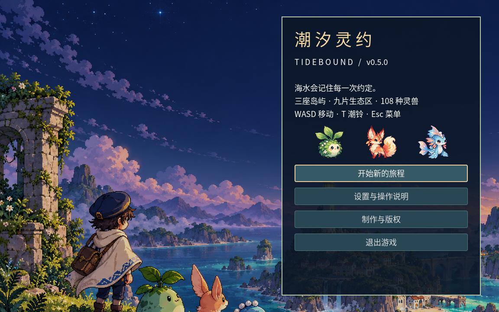
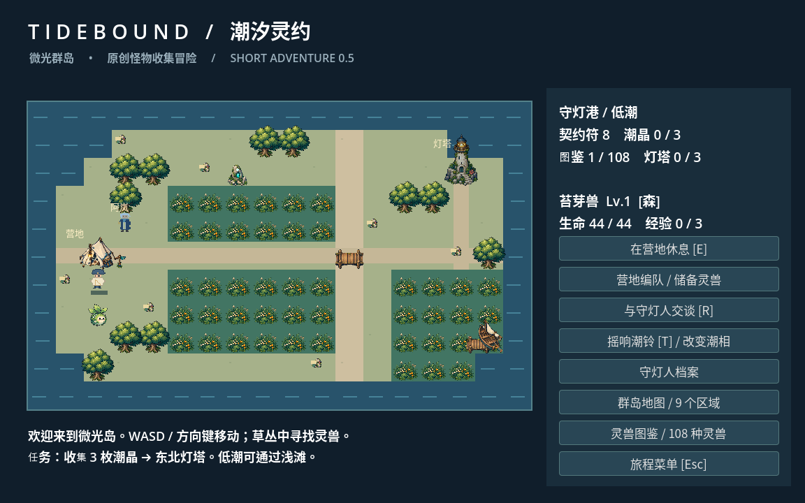
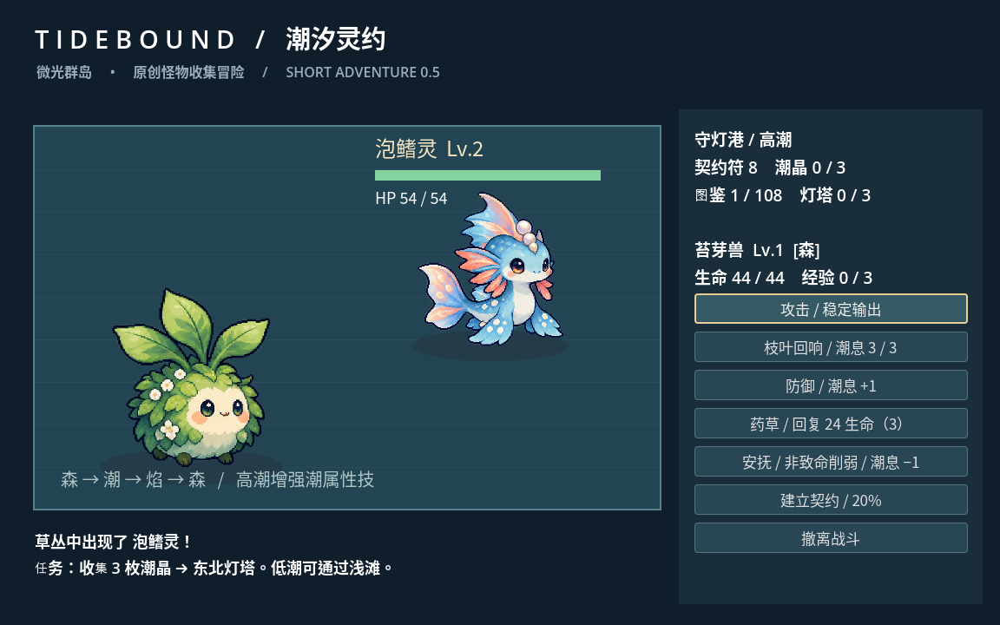
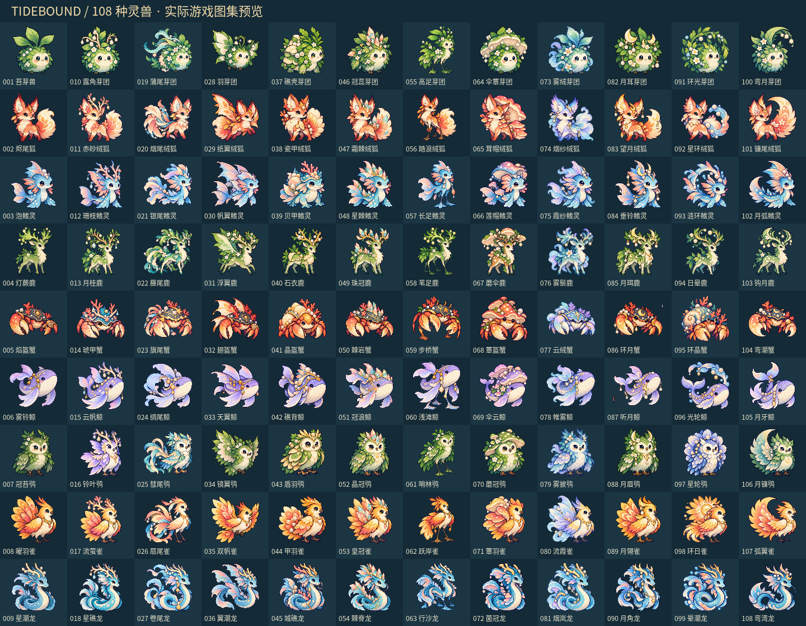

# 潮汐灵约 / Tidebound · v0.5.2

Godot 4.6.3 原创怪物收集单机 RPG **可玩迭代版**。探索三座岛屿、九个生态区域，摇响潮铃改变潮相，结识 108 种灵兽，点亮三座灯塔。已有标题、配乐、战斗捕捉、成长、地图、图鉴、主角档案、储备与结局。

**这是可运行的开发版本，尚未完成商业发布验收，也未提交 Steam。** 108 种宠物目前采用九类基础体型与十二类生态结构设计，已接入 108 张精细 AI 辅助美术；仍需继续审美筛选、物种差异性审查、平衡与真人试玩。



## 导入 Godot 运行

1. 下载本版本 GitHub 源码 ZIP 并解压。
2. 在 **Godot 4.6.3** 项目管理器选择“导入”，打开 `project.godot`。
3. 等待字体、音频、图片导入完成，按 **F5**。

无需 Windows/Linux 平台源码、Visual Studio、C++、Python、联网账户或额外插件。游戏运行只需要 Godot；Python 和 shell 脚本仅为开发辅助工具。素材全部在项目内，包含中文字体和许可。`.godot` 缓存不随源码交付，由编辑器重新生成。

## 操作与玩法

- **WASD / 方向键**移动；**T** 摇潮铃；**E** 在营地休息；**R** 与阿岚交谈；**Esc** 打开菜单；鼠标选择按钮。
- 主角洛汐出生在帐篷前，同伴会跟随探索；可在营地与守灯人阿岚交谈，领取本岛生态委托和物种线索。每岛记录六种灵兽后可领取一次奖励及永久 +2% 契约成功率。
- 草丛随机遭遇灵兽。低潮/高潮出现不同物种，每个区域共有 12 种，三岛共 108 种。
- 普通攻击、防御恢复潮息，共鸣技消耗 2 点。森克潮、潮克焰、焰克森；低潮增强焰技，高潮增强潮技。
- **安抚**消耗 1 点潮息，非致命地降低对方生命，避免高等级同伴误击倒收集目标。契约按钮显示当前成功率。
- 每场战斗有 3 份药草；切换同伴会消耗回合。守卫每三回合蓄力重击，有明确预告。
- 队伍最多 6 只，储备最多 200 只。在营地可换队、查看储备或确认解除契约；图鉴永久保留。
- 战斗胜利或捕捉获得潮晶，三枚潮晶唤醒东北灯塔守卫；点亮灯塔后解锁下一岛。
- 在**群岛地图**选择各生态区域，查看收集进度；六块潮碑按潮相显现，提供叙事、补给与小幅捕捉增益。
- 三灯塔完成主线结局；108 种收藏完成后解锁本地称号“群岛之友”。没有接入 Steam 成就。
- 标题、三岛、普通战斗与守卫战使用六首不同合成配乐；设置中可调音量、全屏、减少动态效果。
- 基础手柄映射：方向键/摇杆移动、Start 菜单、X 潮铃、Y 营地休息；按钮可用焦点导航。手柄仍需真实设备验收。

## 存档

战斗奖励、营地休息、区域移动会自动保存，也可从旅程菜单手动保存。下次启动自动恢复。

存档为 Godot `user://tidebound_v2.json`，保留上一份 `.bak`。先校验整份数据再更新状态；主文件损坏时尝试有效备份。开始新旅程需确认覆盖。v0.2/v0.3 存档兼容，早期 v0.1 存档不迁移。

云环境启动辅助：

```bash
bash scripts/run.sh
```

无图形桌面的云机器只能进行无窗口检查；实际游玩使用本地 Godot 编辑器。云数据目录默认在 `/workspace/.tidebound/data`，普通本地编辑器使用操作系统的标准 Godot 用户目录。

## 测试与打包源码

```bash
bash scripts/run.sh --headless --editor --quit
bash scripts/test.sh           # 系统、UI、108 宠物目录与存档检查
bash scripts/test.sh --full    # 再运行战斗进程与完整收藏模拟
bash scripts/test.sh --journey # 新档真实按键/鼠标走完九区、108 收藏、灯塔及委托（约两分钟）
python3 scripts/package.py 0.4.0
```

稳定检查：33 项系统、29 项 UI、679 项目录/资源检查通过。20 个随机种子共 246 场战斗均可完成三灯塔。后期等级测试通过真实安抚/契约动作招募 107 种野生灵兽，142 次契约符尝试，验证完整收藏及保存。模拟跳过步行时间，完整收藏测试采用后期等级，**不能据此预测新玩家通关时间或代替真人试玩**。

实际图形检查覆盖标题、探索、战斗、设置、图鉴、详情、地图与档案；检查 1024×768、1280×720、1920×1080 窗口，按参考画布保留纵横比。详见 [测试记录](docs/TESTING.md)。

开发工具（非运行依赖）：`build_catalog.py` 重建目录数据；`bake_audio.gd` 用 Godot 重建 WAV 配乐；`package.py` 只打包 Godot 项目源码，排除 Git、缓存、存档和引擎二进制。

## 制作与发行

- [设计与发行路线](docs/ROADMAP.md)
- [迭代记录](docs/CHANGELOG.md)
- [宠物目录](docs/PET_CATALOG.csv)
- [素材来源与 AI 使用记录](docs/ASSETS.md)
- [已核验的技能与安装记录](docs/SKILL_REVIEW.md)

原创项目源码目前没有授予公共开源许可证；Godot、Noto 字体及仅供开发的技能分别遵循随附第三方许可证。宠物、场景物件、角色立绘与标题插画使用 AI 生成/迭代素材，正式 Steam 发行前需按平台当时的内容调查要求准确披露并完成权利审查。运行版本不采集遥测、不含内购、不需要网络。

## 实际游戏画面







另有新档端到端验证：真实移动与 GUI 点击，在 10 倍模拟时间下完成 108 图鉴、三灯塔、三生态委托，两次均完成 155 场遭遇、663–667 次战斗操作、779–792 步，零全队倒下。未直接修改生命、等级或任务进度；该结果仍不能代替真人游戏性评价。
