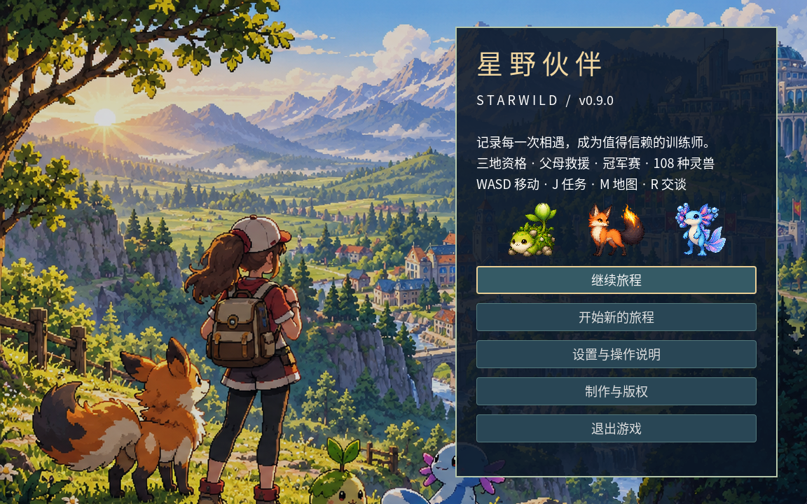
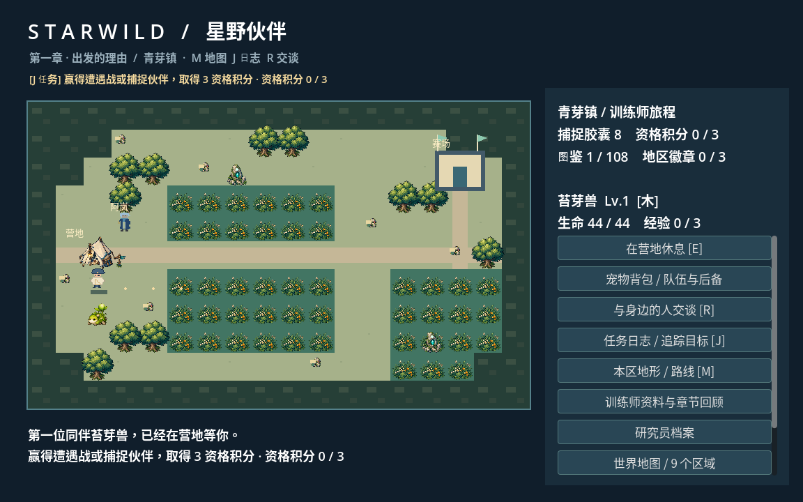
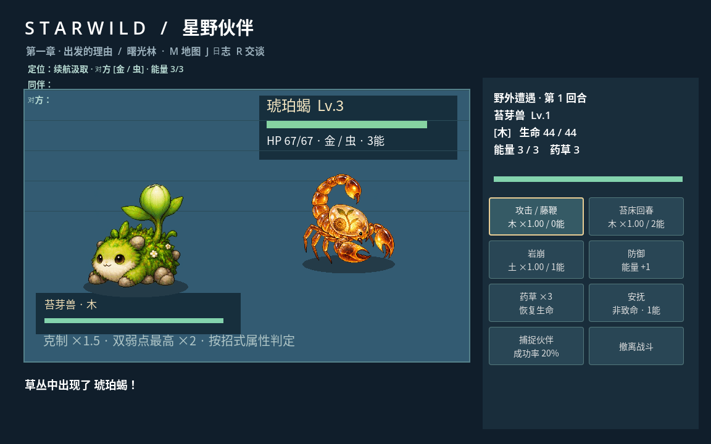
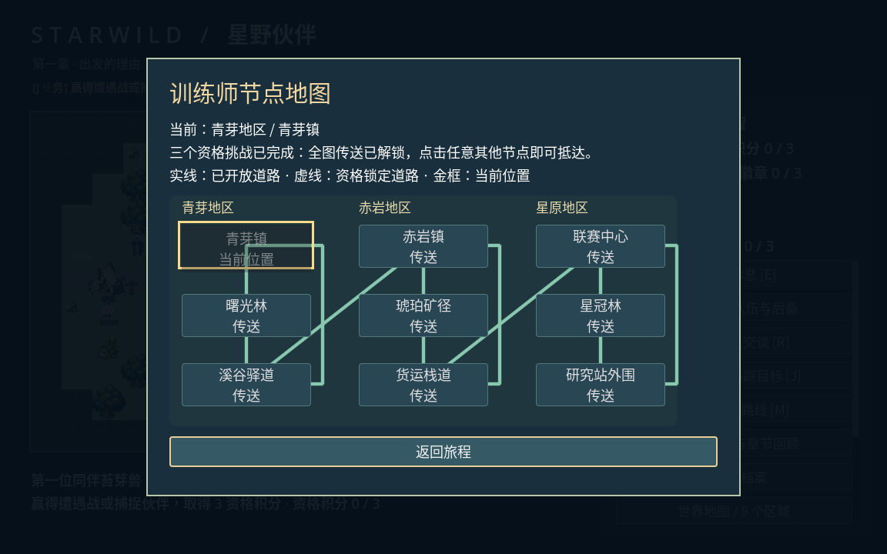
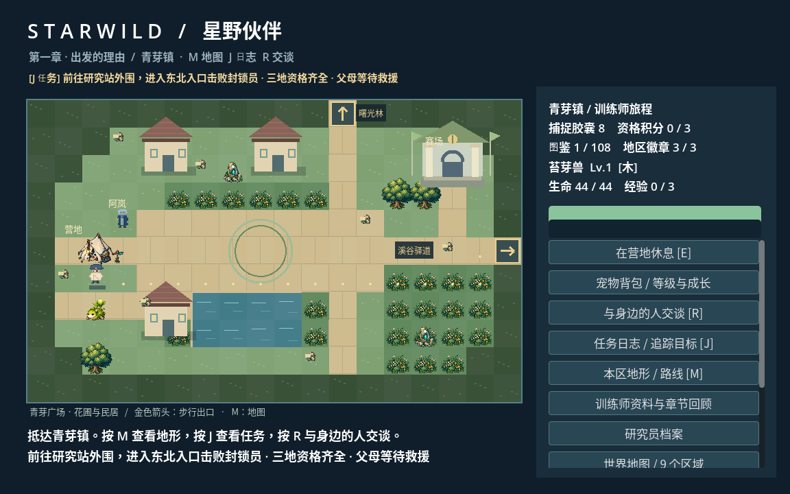
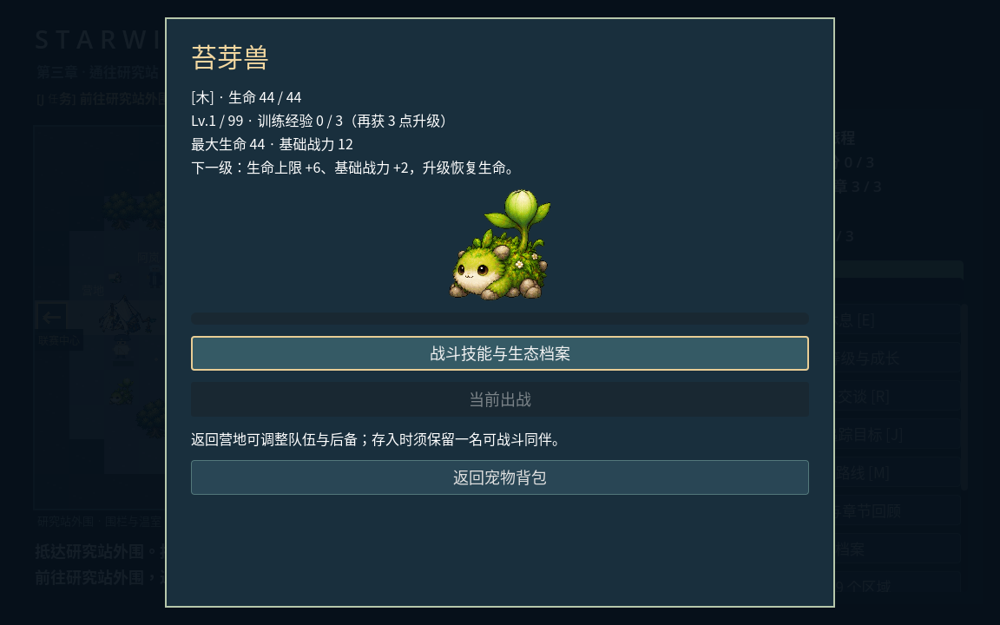

# 星野伙伴 / Starwild · v0.10.0

Godot 4.6.3 原创伙伴收集与训练师冒险 **可玩开发版**。108 种伙伴、十二属性、每宠最多两种属性与三项可选技能。主线围绕图鉴调查、地区资格赛、父母救援和冠军赛展开。



尚未完成商业发布验收，未提交 Steam。当前交付为 Godot 项目源码，不含平台二进制或引擎源码。

[完整游戏设计文档](docs/GAME_DESIGN.md)

## 导入运行

用 Godot 4.6 打开项目中的 `project.godot`，按 F5。游戏运行不需要 Python、网络或额外插件。

云环境可执行 `bash scripts/run.sh`，脚本为工作区配置可写的用户数据目录。

## 剧情与主线

洛汐的父母是失联的生态研究员。阿岚发现有人伪造伙伴的运输记录，图鉴调查能够提供证据，训练师资格则能开启后续地区与调查许可。

1. 青芽、赤岩、星原三个地区，各通过野外胜利或捕捉取得 3 资格积分，挑战地区导师。资格赛首次获胜会指导全队提升一级。
2. 三枚徽章取得后，前往「研究站外围」东北入口，完成封锁员的两只伙伴救援战，救出父母。
3. 父母获救后回「联赛中心」，挑战许澈的三只伙伴阵容，完成冠军赛。对手换宠不会重置本场药草或己方能量。
4. 主线结束后可继续完成区域委托、回顾剧情和收集全部 108 种伙伴。全图鉴不是救援或冠军赛门槛。

新版移除了灯塔、涨退潮、环境切换遭遇与水火环境增伤。本区地形通道不受环境开关影响；跨地区道路由资格挑战逐步解锁，每区 12 种伙伴全天可遇见。

## 操作与任务

| 操作 | 功能 |
|---|---|
| WASD / 方向键 | 移动 |
| R | 与身边 NPC 或赛场接待交互 |
| J | 主线、可选委托、追踪目标和章节回顾 |
| M | 本区地形与追踪路线，可进入世界地图 |
| E | 营地免费恢复与胶囊补给 |
| Esc | 菜单 / 返回 |
| 鼠标、Tab / 方向键、Enter | 选择界面操作 |

阿岚提供父母、联赛和温和捕捉的分支对话；茵禾需要四种本区图鉴记录；乔渡的三个地区巡查问题不同。可选委托奖励只领取一次，不阻塞主线。



## 战斗与伙伴

金、木、水、火、土、风、雷、光、暗、冰、龙、虫。按招式属性计算克制：×1.5，双弱点最高 ×2，其他 ×1；光暗互克、龙克自身，不自动产生反向抵抗。完整关系在游戏内属性手册与 [规则文档](docs/ELEMENTS.md)。

每宠三招：基础招式不消耗能量并恢复 1 点，补盲技消耗 1，专属技消耗 2。能量上限 3。护盾、破甲、标记、回响、灼伤、缓蚀、润泽等效果在状态栏显示；原环境技能改为低生命爆发 / 健康时护盾。

双列操作卡显示技能属性、当前倍率和消耗；药草、安抚、捕捉与撤离直接可见。训练师伙伴不能捕捉，普通野外伙伴可以安抚后捕捉。队伍倒下会送回营地，不会永久失去伙伴。

背包支持六只随行、200 只后备、查看个体、选择出战与营地交换。不能存入最后一名健康伙伴，编队自动保存。



## 存档与兼容

保留旧版的用户目录标识和 `tidebound_v2.json` 文件名，避免因项目改名丢失存档。旧版三座灯塔完成记录迁移为三地资格；旧环境字段被忽略。旧档可继续进行新的救援和冠军赛，无需重新收集伙伴。

新 NPC 对话、委托、追踪目标、救援及冠军状态会保存。存在原子写入、备份与损坏恢复。战斗中退出会回到此前的自动存档，不保存半场战斗。

## 开发验证

```bash
bash scripts/test.sh            # 系统、UI、图鉴、技能、属性、剧情、节点地图与兼容
bash scripts/test.sh --full     # 追加 20 种子主线与完整收藏模拟
bash scripts/test.sh --journey  # 新档真实键盘 / GUI 点击走完图鉴与五阶段主线
python3 scripts/package.py 0.10.0
```

测试使用独立临时存档。图形检查使用 Xvfb / Mesa；不能替代玩家设备、手柄和真人试玩。详见 [测试记录](docs/TESTING.md)。

源码、设计与美术使用 AI 辅助创作。宠物、标题与角色立绘的生成来源和 SHA256 见 [素材记录](docs/ASSETS.md)。正式发行前需完成素材权利审查、平台 AI 披露、目标平台构建与真人测试。项目源码未授予公共开源许可证；Godot、字体及开发技能分别遵循随附第三方许可证。

### v0.9.1 节点地图

九个区域以节点和道路连接，地图可点击通行。地区内三点互通，跨区道路为溪谷驿道 ↔ 赤岩镇、货运栈道 ↔ 联赛中心。前期沿相邻道路探索，资格挑战逐步开放地区；完成三个资格挑战后解锁全图直接传送。通行不恢复生命，治疗请在营地休息。按 M → 世界地图，或使用侧栏相邻道路按钮。



### v0.10.0 成长与步行地图

- 直接走到场景边界的金色箭头即可进入相邻地图，从对应入口落地，可原路返回；红色箭头表示资格暂未开放。无需打开地图菜单。
- 主线跨区路线会引导至正确道路出口。世界地图仍保留相邻节点通行和三资格后的全图传送。
- 九区域增加独立环境配色、池塘、广场、石板路、木栈道、民居、矿轨与研究站外观；水域与建筑使用实际碰撞，营地、NPC、补给和主线通道保留可达性。
- 伙伴 Lv.1–99，战斗或捕捉每次获得 1 训练经验。Lv.1–5 每级需 3 点经验，此后每 5 级增加 1 点需求，最高每级 20 点。升级增加 6 最大生命、2 基础战力并恢复生命；资格赛全队一级指导仍保留。
- 探索 HUD 增加生命与经验条；背包显示个体等级与经验，详情页显示成长收益，战斗技能另有档案页。



